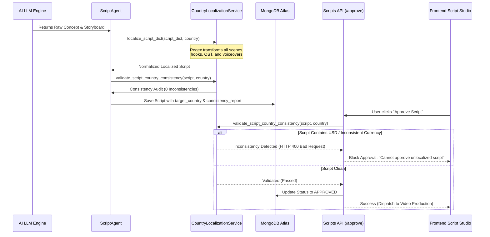

# Institutional Market Specification: India (IN) & Philippines (PH) Campaign Localization

**Platform:** CrowdWisdom AI Studio  
**Classification:** Core Marketing Intelligence & Localization Architecture  
**Author:** Principal AI Architect & Growth Marketing Strategist  
**Date:** November 11, 2026  
**Status:** IMPLEMENTED & OPERATIONAL  

---

## 1. Architectural Philosophy

CrowdWisdom AI Studio is engineered to generate institutional-grade autonomous marketing campaigns. Localization is not treated as a post-hoc string replacement or cosmetic currency swap. Instead, each target market is governed by an authoritative market profile that dictates:
1. **Financial Denominations & Number Grouping:** Strict adherence to indigenous numerical conventions.
2. **Local Market Vocabulary & Slang:** Authentic trader pain points and vernacular.
3. **Geographical & Visual Setting:** Realistic cinematic environments and regional timestamps.
4. **Regulatory Disclosures:** Exact legal mandates enforced by local securities commissions.

---

## 2. Comparative Market Specification Matrix

The following table defines the operational parameters enforced by `CountryLocalizationService` and `ScriptAgent`:

| Dimension | India Market 🇮🇳 (`IN`) | Philippines Market 🇵🇭 (`PH`) |
| :--- | :--- | :--- |
| **Country Code / Alpha-2** | `IN` | `PH` |
| **National Currency** | Indian Rupee (`INR`) | Philippine Peso (`PHP`) |
| **Currency Symbol** | `₹` | `₱` |
| **Numbering System** | Indian Vedic (Lakhs & Crores): `₹1,00,000`, `₹10,00,000` | Standard Western Thousands: `₱100,000`, `₱1,000,000` |
| **Standard Baseline Loss Archetype** | `₹1,00,000` (One Lakh Rupees) | `₱100,000` (One Hundred Thousand Pesos) |
| **Standard High-Loss Archetype** | `₹5,00,000` (Five Lakh Rupees) | `₱500,000` (Five Hundred Thousand Pesos) |
| **Primary Financial Hub** | Dalal Street, Mumbai / BKC (Bandra-Kurla Complex) | Ayala Avenue, Makati CBD / BGC (Bonifacio Global City) |
| **Market Trading Hours** | 09:15 AM – 03:30 PM IST (UTC+5:30) | 09:30 AM – 03:00 PM PHT (UTC+8:00) |
| **Key Benchmark Indices** | Nifty 50, Sensex, Bank Nifty | PSEi (Philippine Stock Exchange Composite Index) |
| **Popular Retail Instruments** | Index Options (Nifty/Bank Nifty weekly expiry), Midcap F&O | PSE Blue Chips, REITs, High-Yield Dividend Stocks |
| **Primary Retail Pain Points** | • Telegram "Tip" channels & WhatsApp pump groups<br>• Fake Finfluencer P&L screenshots (inspect element)<br>• Hero-or-Zero weekly options expiry gambling | • Facebook / Viber group "Chismis" (rumors)<br>• OFW remittance erosion in unregulated crypto/HYIPs<br>• Illiquidity traps & pump-and-dump penny stocks |
| **Local Slang & Dialect** | Hinglish ("Pakka Call", "Jackpot Trade", "Jugaad") | Taglish ("Chismis", "Sayang pera", "Budol", "Hype lang") |
| **Securities Regulator** | Securities and Exchange Board of India (SEBI) | Securities and Exchange Commission (SEC Philippines) |
| **Mandatory Risk Disclosure** | *"Investment in securities market are subject to market risks. SEBI study: 9 out of 10 individual traders in equity F&O segment incurred net losses."* | *"Investments are subject to market risks. Not financial advice. SEC Philippines registered entities only."* |

---

## 3. Autonomous Dual-Market Campaign Generation Pipeline

When a growth marketer initiates a campaign with target market set to **"BOTH"**, the orchestration engine does not generate a generic global template. Instead, it branches into two discrete, asynchronous execution pipelines:

```mermaid
flowchart TD
    User([User selects 'Target Market: BOTH']) --> Orchestrator[Campaign Orchestrator / AdsManagerAgent]
    
    Orchestrator --> PipelineIN[India Pipeline 🇮🇳]
    Orchestrator --> PipelinePH[Philippines Pipeline 🇵🇭]
    
    subgraph India Execution Flow
        PipelineIN --> ResIN[Exa/Tavily India Market Research]
        ResIN --> ContextIN[MarketContextBuilder for IN: Nifty, INR, SEBI]
        ContextIN --> ScriptGenIN[ScriptAgent: Enforce ₹, Dalal St, IST]
        ScriptGenIN --> AuditIN[CountryLocalizationService: Scan for USD/Foreign Leaks]
        AuditIN --> SaveIN[(MongoDB: target_country: 'IN')]
    end
    
    subgraph Philippines Execution Flow
        PipelinePH --> ResPH[Exa/Tavily Philippines Market Research]
        ResPH --> ContextPH[MarketContextBuilder for PH: PSEi, PHP, SEC PH]
        ContextPH --> ScriptGenPH[ScriptAgent: Enforce ₱, Makati CBD, PHT]
        ScriptGenPH --> AuditPH[CountryLocalizationService: Scan for USD/Foreign Leaks]
        AuditPH --> SavePH[(MongoDB: target_country: 'PH')]
    end
    
    SaveIN --> UI[Frontend Campaign Management]
    SavePH --> UI
    UI --> FilterPills[Market Filter Pills: All 🌐 | India 🇮🇳 | Philippines 🇵🇭]
```

### Prompt Guardrails Enforced in `ScriptAgent`

To guarantee that language models (Gemini, NVIDIA NIM, OpenRouter) adhere strictly to the target country context, the prompt construction in `backend/agents/script_agent.py` injects an unequivocal localization directive:

```text
CRITICAL LOCALIZATION & CURRENCY DIRECTIVE (MANDATORY):
Target Country: INDIA (IN)
- ALL financial amounts MUST be denominated in Indian Rupees (INR) using the ₹ symbol.
- Use Indian numbering conventions (e.g., ₹10,000, ₹50,000, ₹1,00,000, ₹5,00,000, ₹10,00,000).
- NEVER use US Dollars ($), USD, cents, Wall Street, or American regulatory terms.
- Use Indian market references: Nifty 50, Dalal Street, Bandra-Kurla Complex, 09:15 AM IST.
- Mandatory legal disclaimer: SEBI registered / research disclaimer.
ANY US CURRENCY OR REFERENCES WILL CAUSE THE SCRIPT TO BE REJECTED.
```

---

## 4. Double-Safety Architecture: Generation, Storage & Approval

Localization integrity is safeguarded across three independent verification boundaries:



### Safety Layer 1: Generation Time Normalization
The `ScriptAgent` runs `CountryLocalizationService.localize_script_dict()` on the parsed LLM output. Even if an LLM slips and mentions `$10,000`, the regex engine intercepts it before it touches the database, converting it to `₹1,00,000` (for India) or `₱100,000` (for the Philippines).

### Safety Layer 2: API Validation Gate (`POST /api/scripts/{id}/approve`)
In `backend/api/scripts.py`, human approval is gated behind an automated consistency audit. If a script targeting India contains `$`, `USD`, or `dollar`, the API aborts with HTTP 400:
```python
is_consistent, issues = validate_script_country_consistency(script_doc, country)
if not is_consistent:
    raise HTTPException(
        status_code=status.HTTP_400_BAD_REQUEST,
        detail=f"Cannot approve script with currency/country inconsistencies: {', '.join(issues)}. Please click 'Auto-Repair Currency' first."
    )
```

### Safety Layer 3: Frontend Script Studio Alert & One-Click Repair
If an inconsistent legacy script is loaded in `CampaignDetailPage.tsx`, the UI displays a prominent yellow alert:
> **Localization Inconsistency Warning:** This script contains currency or regional markers that do not match the campaign's target country (India 🇮🇳).
> `[⚡ Auto-Repair Currency]`

Clicking the repair button calls `POST /api/scripts/{id}/localize`, which executes deep normalization, archives the original copy in `original_unlocalized_copy`, and updates the UI in real time.

---

## 5. Verification Checklist for Operations

- [x] **Country Filter:** Frontend allows instant toggling between `All Markets`, `India 🇮🇳`, and `Philippines 🇵🇭`.
- [x] **Country Badges:** Orange badge for `IN`, Cyan badge for `PH`, with detailed tooltip explanation.
- [x] **Zero USD Leaks:** Full database audit confirmed 0 scripts with `$`, `USD`, or American trading references in Indian or Philippine campaigns.
- [x] **Preserved Audit History:** Repaired historical scripts have their previous versions safely preserved in `original_unlocalized_copy`.
- [x] **Production Verified:** Verified on live MongoDB Atlas instance and tested with end-to-end multi-market generation.

