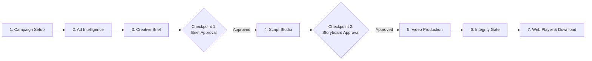
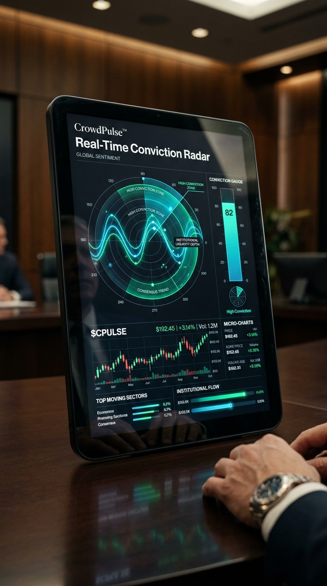
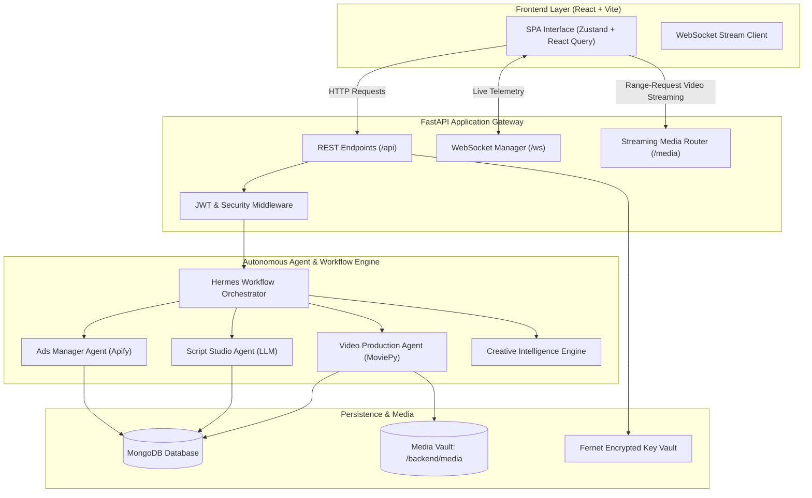

# CrowdWisdom AI Studio

**Autonomous AI Marketing Agent & Cinematic Video Advertising Platform**

> 🚀 **Live Production Platform:** **[https://crowdwisdom-ai-studio-ads.onrender.com](https://crowdwisdom-ai-studio-ads.onrender.com/)**  
> *Experience the autonomous multi-agent marketing & cinematic video advertising studio live in your browser.*

[](https://crowdwisdom-ai-studio-ads.onrender.com/)

[](https://fastapi.tiangolo.com)
[](https://react.dev)
[](https://www.typescriptlang.org)
[](https://vitejs.dev)
[](https://tailwindcss.com)
[](https://www.python.org)
[](https://www.mongodb.com)
[](https://github.com/NousResearch/hermes-agent)

---

## 1. Overview

**CrowdWisdom AI Studio** is an autonomous full-stack AI marketing and cinematic video advertising production platform engineered specifically for financial technology and quantitative trading services (such as [CrowdWisdomTrading.com](https://crowdwisdomtrading.com)).

### The Problem It Solves
Traditional commercial production for financial software requires fragmented tools and disconnected teams:
- Manual competitor ad monitoring across social networks.
- Disconnected copywriting that ignores real market sentiment data.
- Slow, expensive video rendering and motion design pipelines.
- High risk of regulatory and advertising compliance violations.

### How CrowdWisdom AI Studio Solves It
- Orchestrates multi-agent research across the Meta Ads Library to extract live market messaging.
- Synthesizes competitor hooks, trader pain points, and brand USPs into actionable creative briefs.
- Generates 4-scene cinematic storyboards across three distinct strategic marketing angles.
- Enforces strict human-in-the-loop approval checkpoints before expensive rendering begins.
- Assembles broadcast-grade 9:16 vertical 1080x1920 MP4 commercials with AI voiceover and audio ducking.

---

## 2. Key Features

### Autonomous AI Agents
- **Multi-Agent Orchestration**: Hermes-driven agent workflow coordinating research, scriptwriting, and production.
- **Ads Manager Agent**: Discovers, parses, deduplicates, and scores competitor advertising campaigns.
- **Script Agent**: Drafts scene-by-scene production storyboards with narration, on-screen text, and visual cues.
- **Video Production Agent**: Validates media integrity, resolves stock footage, and executes MoviePy composition.
- **Live Agent Telemetry**: Broadcasts step-by-step agent thoughts, tasks, and state transitions over WebSockets.

### Creative Intelligence
- **Ad Discovery & Scraping**: Ingests real competitor ads from Meta Ads Library via Apify integration.
- **Strategic Angle Synthesis**: Identifies emotional triggers, compliance pitfalls, and high-converting angles.
- **Creative Brief Generation**: Converts raw ad observations into structured briefs with target personas.
- **Financial Compliance Guardrails**: Automatically enforces strict restrictions against unrealistic profit promises.

### Cinematic Video Production
- **Multi-Angle Storyboards**: Automatically generates three distinct concepts:
  - *Pain-Point*: Targets emotional trading losses and social media influencer hype.
  - *Unique-Data*: Highlights institutional order-book telemetry and sentiment divergence.
  - *Product-Value*: Showcases verified crowd conviction tools and tactical trade setups.
- **Visual Diversity Engine**: Enforces cross-scene asset diversity to eliminate duplicate plates.
- **Neural Voice Synthesis**: Generates studio-grade voice narration via Edge-TTS with configurable tones.
- **Dynamic Chart Generation**: Renders mathematical candlestick, breakout, and divergence charts on demand.
- **Automated Audio Ducking**: Blends voice narration, ambient music tracks, and UI sound effects.
- **Post-Render Quality Gate**: Probes output MP4 files via FFprobe/FFmpeg to ensure valid duration and playback.

### Campaign Management & Observability
- **Campaign Hub**: Central dashboard to create campaigns, manage target audiences, and view metrics.
- **3 Human-in-the-Loop Checkpoints**:
  - *Checkpoint 1*: Review and approve the synthesized Creative Brief.
  - *Checkpoint 2*: Edit scenes, adjust voiceover narration, and approve the Storyboard.
  - *Checkpoint 3*: Preview, validate, and download final MP4 commercials.
- **Interactive DAG & Kanban**: React Flow visualization of pipeline states and execution queues.
- **Centralized Asset Vault**: Catalog of rendered videos, generated visual plates, and raw stock footage.
- **Audit Logging**: Structured execution logs capturing agent decisions and timing.

---

## 3. How It Works

The platform executes an 8-stage automated pipeline with explicit human governance:



1. **Campaign Creation**: Define the campaign objective, target trader persona, duration (30s/45s/60s), and aspect ratio (9:16).
2. **Advertising Intelligence**: The Ads Manager Agent scrapes recent financial ads, scores competitor hooks, and catalogs visual styles.
3. **Creative Intelligence Engine**: Synthesizes market insights into a structured brief containing key hooks, proof points, and call-to-actions.
4. **Checkpoint 1 (Brief Sign-Off)**: Human review confirms messaging aligns with marketing goals and financial regulations.
5. **Script & Storyboard Studio**: The Script Agent drafts 3 distinct storyboard concepts with timing, camera directions, and narration.
6. **Checkpoint 2 (Storyboard Sign-Off)**: Review scene visuals, edit script copy, and authorize the video production agent.
7. **Video Production & Composition**: The engine generates visual assets, synthesizes audio narration, builds animated charts, and renders the MP4.
8. **Checkpoint 3 (Delivery & Review)**: The completed commercial is validated via FFprobe and made available for instant playback and download.

---

## 4. Product Preview

| Multi-Agent Command Center & Campaign Hub |
| :---: |
|  |
| *Real-time agent fleet monitoring, campaign throughput, and active execution queue.* |

| Cinematic Video Player & Storyboard Studio | Market Telemetry & Intelligence |
| :---: | :---: |
|  |  |
| *Frame-by-frame storyboard editor with direct MP4 playback.* | *Competitive ad scoring and financial sentiment analytics.* |

---

## 5. Technology Stack

### Frontend
- **Framework**: React 18.3 with TypeScript 5.6
- **Build Tool**: Vite 6.0
- **Styling**: Tailwind CSS 3.4 with custom dark editorial SaaS design system
- **UI Primitives**: Radix UI primitives & shadcn/ui components
- **State Management**: Zustand 5.0 (Authentication, theme, and persistent UI state)
- **Data Fetching**: TanStack React Query 5.62
- **Workflow Visualization**: React Flow 11.11 & Recharts 2.13
- **Icons**: Lucide React

### Backend
- **Framework**: FastAPI 0.115+ (Python 3.11+)
- **Server**: Uvicorn (ASGI) & Gunicorn
- **Database Driver**: Motor 3.6+ (Async MongoDB) & PyMongo 4.9+
- **Agent Framework**: Hermes Agent Adapter Layer (`NousResearch/hermes-agent`)
- **Validation**: Pydantic v2 & Pydantic-Settings
- **Security & Crypto**: Fernet symmetric encryption (`cryptography`), Passlib (`bcrypt`), Python-Jose (`JWT`)

### Video & Audio Production Engine
- **Video Composition**: MoviePy 1.0.3 & OpenMontage Video Adapter
- **Encoder / Probe**: ImageIO-FFmpeg & FFprobe
- **Image Processing**: Pillow 10.4+ & NumPy 2.1+
- **Voiceover Synthesis**: Edge-TTS 7.0+ (Neural speech generation)

### External Integrations
- **LLM Reasoning**: OpenRouter (Llama 3.1 70B Instruct), NVIDIA NIM (`nemotron-3.5-bolt`), Google Gemini
- **Ad Scraping**: Apify Meta Ads Library Scraper
- **Web Intelligence**: Tavily Search & Exa Neural Search
- **Visual Synthesis**: Pollinations AI & bundled verified 1080x1920 30fps commercial footage catalog

---

## 6. Architecture



---

## 7. Repository Structure

```text
CrowdWisdom-AI-Studio/
├── backend/                       # Python FastAPI Backend
│   ├── main.py                    # Application entry point, CORS, routes & docs
│   ├── config.py                  # Pydantic environment configuration
│   ├── requirements.txt           # Python dependencies
│   ├── agents/                    # Specialized autonomous agents
│   │   ├── base_agent.py          # Abstract agent base with DB logging
│   │   ├── ads_manager_agent.py   # Meta Ads scraping & scoring agent
│   │   ├── script_agent.py        # 4-scene storyboard generation agent
│   │   └── video_production_agent.py # Compositing & post-render validation
│   ├── api/                       # REST API & WebSocket endpoints
│   │   ├── auth.py                # User login, registration & JWT issuing
│   │   ├── campaigns.py           # Campaign CRUD & duplication
│   │   ├── agents.py              # Agent task dispatch & queue telemetry
│   │   ├── scripts.py             # Storyboard editing, approval & asset resolution
│   │   ├── videos.py              # Video job rendering & status polling
│   │   ├── research.py            # Competitor ad catalog & scoring
│   │   ├── dashboard.py           # Studio KPIs, video & asset streaming
│   │   └── websocket.py           # Real-time event broadcasting
│   ├── database/                  # Async MongoDB connection & indexes
│   ├── integrations/              # LLM, Apify, Tavily & Exa client wrappers
│   ├── orchestrator/              # Hermes pipeline orchestrator & state machine
│   ├── services/                  # Business logic services
│   │   ├── creative_intelligence_engine.py # Strategic brief synthesis
│   │   ├── visual_asset_service.py # Image generation, stock footage & deduplication
│   │   ├── tts_service.py         # Neural speech synthesis
│   │   ├── sound_design_service.py # Audio ducking & soundtrack mixing
│   │   └── integration_service.py # Fernet symmetric key encryption
│   ├── tests/                     # Pytest automated test suite
│   ├── utils/                     # Setup, seed & smoke testing scripts
│   └── video_engine/              # MoviePy compositing & OpenMontage adapter
├── frontend/                      # React 18 + TypeScript + Vite Frontend
│   ├── src/
│   │   ├── components/            # Layout, Navigation & UI primitives
│   │   ├── pages/                 # 12 studio application views
│   │   │   ├── auth/              # Premium editorial login & registration
│   │   │   ├── dashboard/         # Studio KPI dashboard
│   │   │   ├── campaigns/         # Campaign hub & detailed management
│   │   │   ├── agents/            # Live agent fleet command center
│   │   │   ├── scripts/           # Script studio & storyboard editor
│   │   │   ├── videos/            # Video production queue & web player
│   │   │   ├── workflow/          # Interactive React Flow DAG & Kanban
│   │   │   ├── assets/            # Media library & downloads
│   │   │   └── settings/          # Encrypted integration vault
│   │   ├── lib/                   # Axios client, media URL resolver & utilities
│   │   ├── stores/                # Zustand global stores (auth, theme)
│   │   └── types/                 # TypeScript interfaces and schemas
│   ├── public/                    # Static assets, branding, and showcase previews
│   │   └── _redirects             # Render SPA fallback rewrite rule
│   ├── package.json               # Frontend dependencies & scripts
│   └── vite.config.ts             # Vite configuration with backend proxy
├── scripts/                       # Developer & pre-commit security scripts
│   └── git_secret_check.py        # Pre-commit secret leak prevention scanner
├── .env.example                   # Safe environment variable configuration template
└── README.md                      # Platform documentation
```

---

## 8. Installation and Local Setup

### Prerequisites
- **Python**: Version `3.11` or higher.
- **Node.js**: Version `20.18.0` or higher.
- **Package Manager**: `pnpm` (version 9 or higher).
- **Database**: Local MongoDB instance (`mongodb://localhost:27017`) or a free [MongoDB Atlas](https://www.mongodb.com/atlas) cluster.
- **Media Engine**: `ffmpeg` (automatically resolved via `imageio-ffmpeg` or system PATH).

---

### Step 1: Clone the Repository

```bash
git clone https://github.com/Dashwanth15/CrowdWisdom-AI-Studio.git
cd CrowdWisdom-AI-Studio
```

---

### Step 2: Configure Environment Variables

Copy the template to create your `.env` file in the project root:

```bash
# On Windows PowerShell:
Copy-Item .env.example .env

# On Linux / macOS:
cp .env.example .env
```

Open `.env` and configure your database and authentication keys:
```ini
APP_ENV=development
APP_SECRET_KEY=generate_a_random_32_character_string_here
JWT_SECRET_KEY=generate_another_random_32_character_string_here
MONGODB_URL=mongodb://localhost:27017
MONGODB_DB_NAME=crowdwisdom_ai_studio
```

---

### Step 3: Backend Setup

1. **Create and activate a virtual environment:**

```bash
# Create virtual environment
python -m venv .venv

# Activate on Windows:
.venv\Scripts\activate

# Activate on Linux / macOS:
source .venv/bin/activate
```

2. **Install backend dependencies:**

```bash
pip install -r backend/requirements.txt
```

3. **Seed initial administrative credentials:**

```bash
# Windows PowerShell:
$env:PYTHONPATH="backend"
python backend/utils/seed_data.py

# Linux / macOS:
PYTHONPATH=backend python backend/utils/seed_data.py
```

---

### Step 4: Frontend Setup

1. **Navigate to the frontend directory:**

```bash
cd frontend
```

2. **Install dependencies using pnpm:**

```bash
pnpm install
```

3. **Return to the project root:**

```bash
cd ..
```

---

## 9. Environment Variables Reference

All credentials and runtime settings are configured via `.env` in the root directory:

| Variable | Required | Default / Example | Purpose |
|---|---|---|---|
| `APP_ENV` | Yes | `development` | Runtime mode (`development` or `production`). |
| `APP_SECRET_KEY` | Yes | *32+ random characters* | Master encryption key for Fernet-encrypted credentials. |
| `APP_HOST` | No | `0.0.0.0` | Backend bind address. |
| `APP_PORT` | No | `8000` | Backend listening port. |
| `FRONTEND_URL` | Yes | `http://localhost:5173` | Allowed frontend origin for CORS policies. |
| `CORS_ORIGINS` | Yes | `http://localhost:5173,...` | Comma-separated list of allowed origins. |
| `MONGODB_URL` | Yes | `mongodb://localhost:27017` | MongoDB local connection string or Atlas URI. |
| `MONGODB_DB_NAME` | Yes | `crowdwisdom_ai_studio` | Database name. |
| `JWT_SECRET_KEY` | Yes | *32+ random characters* | Secret key for signing HS256 JWT tokens. |
| `JWT_ALGORITHM` | No | `HS256` | JWT signing algorithm. |
| `MEDIA_DIR` | Yes | `./backend/media` | Target filesystem directory for generated videos and assets. |
| `OPENROUTER_API_KEY` | Optional* | `sk-or-v1-...` | LLM provider for scriptwriting (OpenRouter). |
| `NVIDIA_NIM_API_KEY` | Optional* | `nvapi-...` | LLM provider for strategic brief analysis. |
| `APIFY_API_TOKEN` | Optional* | `apify_api_...` | Scraper token for Meta Ads Library collection. |
| `TAVILY_API_KEY` | Optional* | `tvly-...` | Web search for financial market sentiment. |
| `EXA_API_KEY` | Optional* | *Exa API key* | Neural semantic search for market angles. |

*\*Note: External API keys can either be set in `.env` or securely added via the Studio **Settings & Integrations** UI. All keys saved through the UI are encrypted at rest using Fernet symmetric encryption.*

---

## 10. Running the Application

### Development Mode

Run backend and frontend in separate terminal windows:

**Terminal 1 — Backend:**
```bash
# Windows PowerShell:
$env:PYTHONPATH="backend"
uvicorn main:app --reload --host 0.0.0.0 --port 8000 --app-dir backend

# Linux / macOS:
PYTHONPATH=backend uvicorn main:app --reload --host 0.0.0.0 --port 8000 --app-dir backend
```

**Terminal 2 — Frontend:**
```bash
cd frontend
pnpm dev
```

- **Frontend Application**: `http://localhost:5173`
- **Default Admin Login**: `admin@crowdwisdom.ai`
- **Default Password**: `admin1234`

---

### Production Mode

**Backend (Gunicorn with Uvicorn Workers):**
```bash
cd backend
gunicorn main:app -w 4 -k uvicorn.workers.UvicornWorker --bind 0.0.0.0:8000
```

**Frontend (Production Static Build):**
```bash
cd frontend
pnpm build
```
The compiled SPA is generated in `frontend/dist/`.

---

## 11. API Documentation

FastAPI automatically generates interactive OpenAPI documentation:

| Endpoint | Method / Type | Description | Local Development URL |
|---|---|---|---|
| **Swagger UI** | `GET` | Interactive OpenAPI documentation | `http://localhost:8000/docs` |
| **ReDoc** | `GET` | Alternative structured documentation | `http://localhost:8000/redoc` |
| **OpenAPI Schema** | `GET` | Machine-readable JSON schema | `http://localhost:8000/openapi.json` |
| **System Health** | `GET` | System health check & DB status | `http://localhost:8000/health` |
| **API Health** | `GET` | Router-prefixed health check | `http://localhost:8000/api/health` |
| **Live WebSocket** | `WS` | Real-time agent events stream | `ws://localhost:8000/ws/{client_id}` |
| **Media Delivery** | `GET` | Video streaming with HTTP 206 Range | `http://localhost:8000/media/videos/{filename}` |

*Legacy routes (`/api/docs`, `/api/openapi.json`, `/api/redoc`) automatically redirect to standard documentation URLs.*

---

## 12. Automated Testing

The codebase includes an automated test suite covering authentication, API routing, secret security, and the video production pipeline.

### Running Backend Tests

```bash
# Windows PowerShell:
$env:PYTHONPATH="backend"
python -m pytest backend/tests/test_video_pipeline_and_diversity.py backend/tests/test_docs_and_health_routes.py backend/tests/test_auth_flow.py -v

# Linux / macOS:
PYTHONPATH=backend python -m pytest backend/tests/test_video_pipeline_and_diversity.py backend/tests/test_docs_and_health_routes.py backend/tests/test_auth_flow.py -v
```

**Verified Test Coverage:**
- `test_scene_classification_and_diversity`: Verifies semantic tagging and ensures cross-scene non-duplication.
- `test_duplicate_recovery_in_existing_storyboard`: Verifies auto-replacement of duplicate assets.
- `test_post_render_video_validation_gate`: Verifies FFprobe integrity verification.
- `test_docs_and_health_routes`: Validates `/docs`, `/openapi.json`, and health checks.
- `test_auth_flow`: Validates bcrypt password hashing, JWT creation, and role authorization.

### Running Frontend Verification

```bash
cd frontend
pnpm build
```
Executes TypeScript type-checking (`tsc -b`) and Vite production bundle compilation.

### Running Secret Leak Scanner

```bash
# Scans staged files for accidental credential inclusion before commits:
python scripts/git_secret_check.py --staged
```

---

## 13. Production Deployment

The project is structured for zero-downtime deployment on modern cloud platforms (such as Render):

### 1. Backend Web Service (Render)
- **Runtime**: Python 3.11+
- **Root Directory**: `backend`
- **Build Command**: `pip install -r requirements.txt`
- **Start Command**: `uvicorn main:app --host 0.0.0.0 --port $PORT`
- **Environment Variables**: Set `APP_ENV=production`, `APP_SECRET_KEY`, `JWT_SECRET_KEY`, and `MONGODB_URL`.

### 2. Frontend Static Site (Render)
- **Live URL**: [https://crowdwisdom-ai-studio-ads.onrender.com](https://crowdwisdom-ai-studio-ads.onrender.com/)
- **Runtime**: Static Site
- **Root Directory**: `frontend`
- **Build Command**: `pnpm build`
- **Publish Directory**: `dist`
- **Node Version**: `20.18.0` (pinned via `frontend/.node-version`)
- **SPA Routing**: Single Page Application redirects are pre-configured via [`frontend/public/_redirects`](frontend/public/_redirects):
  ```text
  /*    /index.html   200
  ```

---

## 14. Security & Compliance

- **Cryptographic Credential Storage**: External provider keys (OpenRouter, NVIDIA NIM, Apify, etc.) are encrypted at rest using Fernet symmetric encryption derived from `APP_SECRET_KEY`.
- **Pre-Commit Secret Protection**: [`scripts/git_secret_check.py`](scripts/git_secret_check.py) scans every commit to prevent API keys or database connection strings from entering git history.
- **Log Credential Sanitization**: Unhandled exception handlers and log formatters automatically mask MongoDB URIs, JWT tokens, and provider keys.
- **Strict CORS Control**: Explicit origin whitelist with credential verification.
- **HTTP Range Media Streaming**: Media endpoints support `Accept-Ranges: bytes` and HTTP 206 Partial Content, preventing memory exhaustion when streaming large videos.
- **Financial Compliance Rules**: The Creative Intelligence Engine automatically rejects scripts containing prohibited phrases (e.g., guaranteed return claims, false social proof, or fabricated testimonials).

---

## 15. Limitations and Current Status

- **Provider Dependency**: Automated competitor ad scraping requires a valid Apify API token; if omitted, the system falls back to curated offline marketing intelligence records.
- **LLM Reasoning**: Script generation requires either an OpenRouter, NVIDIA NIM, or Gemini API key; mock generation is available for offline smoke testing.
- **Filesystem Storage**: Media files are stored on local disk under `MEDIA_DIR`. For multi-instance horizontal scaling, the `BaseStorageService` can be bound to AWS S3 or Cloudflare R2.
- **Browser Extension CSP**: If running third-party browser extensions with `unsafe-eval`, minor console warnings may appear from the extension itself, which do not affect Studio operations.

---

## 16. Future Roadmap

- [ ] **S3 / Cloudflare R2 Remote Storage**: Native plug-and-play adapter for multi-region cloud object storage.
- [ ] **Direct Social Network Export**: 1-click publishing directly to Meta Ads Manager and TikTok Ads API.
- [ ] **Multi-Tenant Organizations**: Role-based access control (RBAC) supporting multi-user marketing agencies.
- [ ] **Automated A/B Testing Matrix**: Automatic generation of 10 micro-variants per concept for multivariate ad testing.

---

## 17. Contributing

Contributions, bug reports, and suggestions are welcome.

1. Fork the repository.
2. Create a descriptive feature branch:
   ```bash
   git checkout -b feature/amazing-feature
   ```
3. Commit your changes:
   ```bash
   git commit -m "feat: add amazing feature"
   ```
4. Push to the branch:
   ```bash
   git push origin feature/amazing-feature
   ```
5. Open a Pull Request.

---

## 18. License

This repository currently has no declared open-source license. All rights are reserved for **CrowdWisdomTrading.com**.

---

## 19. Acknowledgements

- [Nous Research Hermes Agent](https://github.com/NousResearch/hermes-agent) — Autonomous agent framework.
- [FastAPI](https://fastapi.tiangolo.com) — High-performance Python backend framework.
- [React](https://react.dev) & [Vite](https://vitejs.dev) — Frontend web architecture.
- [Tailwind CSS](https://tailwindcss.com) & [Radix UI](https://www.radix-ui.com/) — Modern UI primitives and styling.
- [MoviePy](https://zulko.github.io/moviepy/) & [ImageIO-FFmpeg](https://github.com/imageio/imageio-ffmpeg) — Programmatic video rendering pipeline.
- [Edge-TTS](https://github.com/rany2/edge-tts) — High-quality neural voice synthesis.
